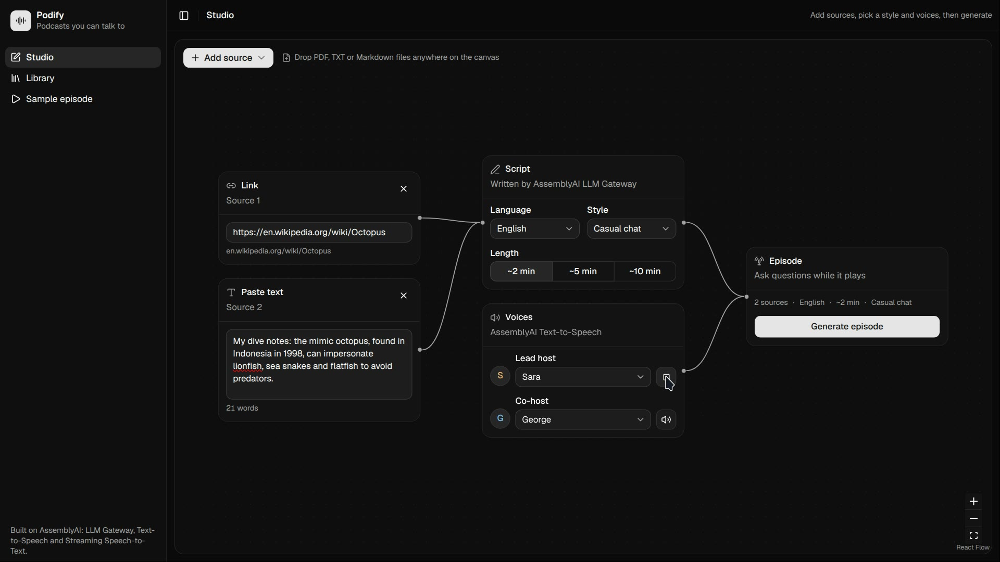
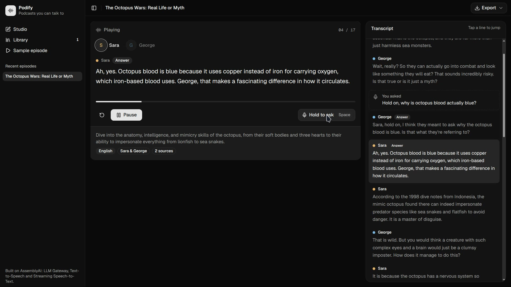
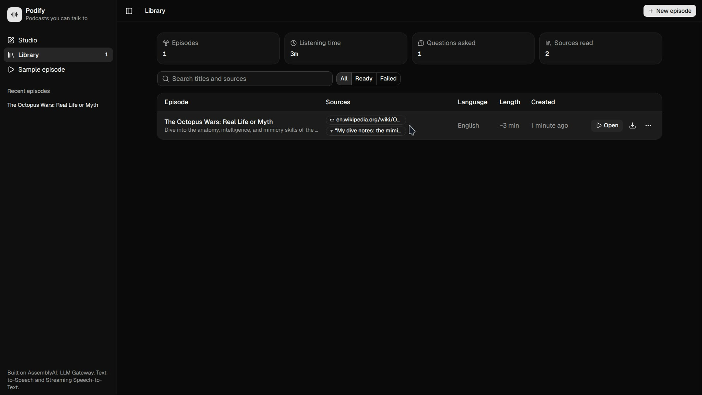

# Podify

**A podcast you can talk back to.** Turn links, GitHub repos, PDFs and notes into a two-host podcast, then hold the mic to interrupt with a question and hear the hosts answer live.

Built for AssemblyAI's Voice Hackathon Week: Hack into Speech.



## Why

Long articles, papers and repos are hard to get through. Audio summaries help, but they are one-way: they can't answer the one question you actually have. Podify makes the episode interactive. Ask out loud at any moment, and the hosts answer from your sources in their own voices, then pick the show back up.

## Features

- **Multiple sources per episode:** web pages, GitHub repos, folders and files, Stack Overflow threads, PDFs, TXT and Markdown uploads, and pasted text.
- **Node canvas studio** built with React Flow, with a stacked layout on phones.
- **Two hosts, six languages:** English, Spanish, French, German, Italian and Portuguese, with voice previews.
- **Hold to ask:** hold the mic button or the space bar, ask a question, and hear a live answer grounded in the sources.
- **Exports:** full episode MP3, timed SRT subtitles, Markdown transcript and JSON. Live Q&A is included.
- **Library:** every run is saved, including failed ones, with search and stats. Reopen, export, retry or remix any run.



## How AssemblyAI is used

| Product | What it does in Podify |
| --- | --- |
| **Text-to-Speech** | Voices every line of the episode and every live answer. Each host has a distinct library voice, and voices speaking outside their native language use the multilingual model. |
| **Streaming Speech-to-Text** | Transcribes spoken questions live, using Universal-3.6 Pro over WebSocket. The browser connects directly with a short-lived token, and episode context is passed as `agent_context`. |
| **LLM Gateway** | Writes the script and the live answers as JSON. Features are detected per model from `/v1/models`, so structured output is used when the model supports it. |

```text
Sources -> text extraction -> LLM Gateway script -> Text-to-Speech -> player
                                                                        |
             hold to ask: mic -> Streaming STT -> LLM Gateway answer -> Text-to-Speech
                                                                        |
                                                  answer plays, episode resumes
```

## Getting started

Requires Node.js 22+ and pnpm.

```bash
pnpm install
cp .env.example .env.local   # add your AssemblyAI API key
pnpm dev
```

Then open <http://localhost:3000>, or go to `/sample` to play a bundled episode straight away.

### Environment variables

| Variable | Required | Purpose |
| --- | --- | --- |
| `ASSEMBLYAI_API_KEY` | Yes | Used by all AssemblyAI calls. It stays on the server; browsers only receive temporary streaming tokens. |
| `LLM_MODEL` | No | LLM Gateway model. Defaults to `qwen3.5-4b-32k-fast`, the model available to free-tier accounts. |
| `SOURCE_CHAR_LIMIT` | No | Total characters read across all sources per episode. Defaults to 24000. |
| `GITHUB_TOKEN` | No | Raises the GitHub API limit for repo metadata and file lists. READMEs load without it. |

## Project structure

```text
src/app/api/          episode, answer, tts, stt-token and extract routes
src/app/              studio, library, episode and sample pages
src/components/       player, library view, app shell, export menu
src/components/studio/ canvas, node cards and studio state
src/components/ui/    shadcn/ui components
src/lib/assemblyai.ts LLM Gateway, TTS and streaming token clients
src/lib/writer.ts     script and live answer prompts
src/lib/sources.ts    link, repo and file loading
src/lib/live-transcriber.ts  mic capture and streaming transcription
src/lib/export.ts     MP3, SRT, Markdown and JSON exports
src/lib/library.ts    saved runs (localStorage)
src/lib/rate-limit.ts per-IP and overall API limits
```

## Tech stack

Next.js 16 (App Router, React 19, TypeScript), Tailwind CSS v4, shadcn/ui, React Flow, Web Audio API with an AudioWorklet, unpdf, Jina Reader, and the GitHub and Stack Exchange APIs.

## Limitations

- The library is stored in the browser, so runs are per device and can't be shared by link.
- Script quality depends on the LLM. The free-tier 4B model works but is noticeably weaker outside English; set `LLM_MODEL` to a larger model if your account has access.
- Some sites block automated reading, such as Medium and Reddit. YouTube videos and scanned PDFs aren't supported. Podify shows a clear error and suggests pasting the text instead.
- API rate limits are kept in memory, so on serverless hosting they apply per instance.


